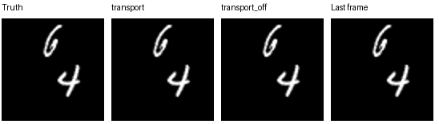
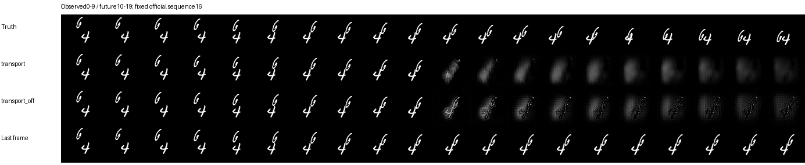
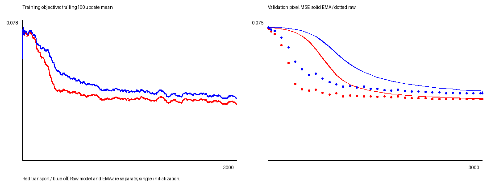

# LHFM-V on an 8 GB Mac — a scaled implementation study

**シンプレクティック幾何学に基づく動画予測モデルの縮小実装と、transportの精度・速度比較。**

[原論文](https://arxiv.org/abs/2609.35710) / [公式実装](https://github.com/Lilas-Q/Geometric_quantization_models) / [詳細な実験結果](RESULTS_RECOVERY.md) / [原設定との対応](FIDELITY_STAGE1.md)

本リポジトリは非公式の研究・学習用実装です。LHFM-Vの構造とtransport–source演算を参照し、M1・8GBで各3,000更新の実験を完了しました。原論文のベンチマーク性能を再現したものではありません。

## 結果

固定validationで選択したEMA checkpointを、公式Moving MNISTの未使用test128系列（ID16–143）で評価しました。

| Model | MSE ↓ | MAE ↓ | SSIM ↑ | PSNR ↑ | CPU latency (ms) ↓ |
|---|---:|---:|---:|---:|---:|
| transport | 130.300531 | 309.159378 | 0.496393 | 15.143122 | 323.934 |
| transport-off | 146.544421 | 338.656171 | 0.440113 | 14.757244 | 34.782 |
| last-frame | 280.055249 | 331.154181 | 0.665462 | 11.836533 | 未測定 |

- transportのMSEはoffより**11.08%低い**一方、CPU推論は**9.31倍**の時間でした。
- **可視品質は不十分**です。transportには強いぼけ・形状喪失、offには残像・格子状ノイズが見られます。last-frameのSSIMは両モデルより高く、MSE改善だけで良質な動画予測ができたとは判断しません。
- 単一seedの記述的比較です。統計的有意差・一般的優位性・シンプレクティック保存の効果は主張しません。

MSE/MAEはclip前の画素平均誤差×4096の空間和です。SSIMはclip後range2、PSNRはclip後frame単位。CPU latencyは2 threads・batch1・10観測→10予測、3 warmup＋10 forwardの中央値です。入力転送・読込・lossは除外し、計算される未使用aux headは含みます。

## 予測の可視化

固定test系列16の比較。表示は0–1にclipしています。美しく見える例を選んだものではありません。







[系列17](runs/recovery2/official_sequence_17.png) / [系列18](runs/recovery2/official_sequence_18.png) / [系列19](runs/recovery2/official_sequence_19.png)

## シンプレクティック幾何学との関係

原理は、連続画像Fに補助変数aを加え、生成関数S(x,a)=aᵀF(x)からexact Lagrangian graph(dS)を作ることです。そのHamiltonian変形から、画像発展を

```math
\partial_t F = R - DF\,U
```

と表します。Uが空間移動（transport）、Rが移動に沿った色・明るさの変化（source）です。

本実装はネットワークが予測したtransport/sourceから画像を更新します。理論上の拡張空間のHamilton流と、格子上の数値積分は区別します。**二次upwind＋shifted exponentialの離散実装にシンプレクティック保存保証はありません。** 幾何学的構成は原論文§4、実装上の対応は[FIDELITY_STAGE1.md](FIDELITY_STAGE1.md)を参照してください。

## 実験条件と実行経緯

| 項目 | 設定 |
|---|---|
| 環境 | Apple M1、8GB、Python3.12、FP32、CPU2 threads |
| データ | 64×64、2数字、10観測＋10未来 |
| 学習 | seed1017、batch1、各3,000更新、同じ系列順 |
| モデル | 幅(8,16,24)、総65,893 params |
| 選択 | 固定val32系列、35検証点の最小EMA raw pixel MSE |
| テスト | 選択後に公式test ID16–143を評価 |
| transport数値計算 | dt0.5、二次upwind、zero-exterior、source込み24次shifted exponential、適応分割 |

transportはMPSで保護停止後に復旧し、更新1–787をMPS、788–3000をCPUで実行しました。offは全てCPUです。両者の最終評価・速度測定はCPUです。このため完全同一deviceの学習対照ではありません。

CPU復旧から全処理完了までは約85分。transportのCPU継続は約71.5分、offの全学習は約12.4分（検証込み）。復旧前MPS実行は別です。保護停止は全体swap増加基準によるもので、学習単独OOMやMacでの実行不能を意味しません。

固定test16ではtransportに20 half-step・101内部区間・2,424 stencil評価があり、offは0です。Conv/Linearのみの部分MAC数50,534,400はこの追加計算等を含まず、総FLOPsではありません。offの有効パラメータ数は63,733で、完全等容量・等計算量比較ではありません。

## 実行方法

**ランナーの資源監視はmacOSのsysctlを使用します。** 他OSでの動作は検証していません。公式データ・venv・巨大raw予測配列は同梱しません。

```bash
python3.12 -m venv .venv
.venv/bin/python -m pip install -r requirements-lock.txt
.venv/bin/python -m unittest discover -s tests -v
.venv/bin/python smoke.py --output smoke-new
```

smokeは16pxの小fixtureで、元の64px学習実験とは別です。

### 保存モデルから単例を再生成（データの追加取得不要）

```bash
.venv/bin/python regenerate.py runs/recovery2/transport/best_ema.pt runs/recovery2/example_official_16.npz --output regenerated-transport.npz
.venv/bin/python regenerate.py runs/recovery2/transport_off/best_ema.pt runs/recovery2/example_official_16.npz --output regenerated-off.npz
```

### 実験をCPU checkpointから再開

```bash
.venv/bin/python download_data.py --mnist --official-test
.venv/bin/python recovery2.py --device cpu --output runs/recovery-cpu-new --official-test data/mnist_test_seq.npy
.venv/bin/python summarize_recovery2.py runs/recovery-cpu-new
```

これは**787更新時の保存状態からの再開**で、ゼロから全てCPUで学習する手順ではありません。公式testは約819MBです。時間上限なし、RSS高水位1.5GiB・driver1GiB・全体swap増加256MiBの保護を維持します。新しい未存在の出力先を指定してください。[詳しい履歴と手順](README_RECOVERY.md)。

## ファイル案内

| ファイル | 内容 |
|---|---|
| architecture.py | 縮小モデル、attention memory、planner、source/transport、feedback |
| operators.py | 空間operator、時間積分、損失、schedule |
| dataset.py / download_data.py | データ生成と公式データのchecksum検証 |
| tests/ | 数式・構造・評価・resumeの独立検証 |
| runs/recovery2/summary.json | 最終指標・latency生値・選択update |
| runs/recovery2/paired_sequence_mse.csv | 同一test系列ごとの比較 |
| runs/recovery2/ | 最終checkpoint、曲線、予測画像、学習・検証ログ |
| runs/stage1/ / runs/recovery1/ | 保護停止と復旧prefixの履歴 |
| RESULTS_RECOVERY.md | 完了実験の詳細 |
| RESULTS.md / FIDELITY_INHERITED.md | 過去の部分実験。最終結果と混同しないこと |

## 限界と出典

幅・batch・学習回数・評価subsetを大きく縮小しています。原幅・125万更新・全testでの再現、複数seedの頑健性は未確認です。公式コードとの同重みforward一致も未検証です。

原資料はJiawei Hu, *Lagrangian–Hamiltonian Flows for Video Prediction and Image Generation: A Symplectic Perspective*, arXiv:2609.35710。参照commitは`979a41de542f7b190549fc94a8803a56530e4a00`です。参照ファイルのhashは[REFERENCE_MANIFEST.json](REFERENCE_MANIFEST.json)にあります。

コード・実験記録の作成にはAI支援を使用しています。公開に伴い新たな学習は実行していません。著作物の出典と利用条件については[ATTRIBUTION.md](ATTRIBUTION.md)を参照してください。
